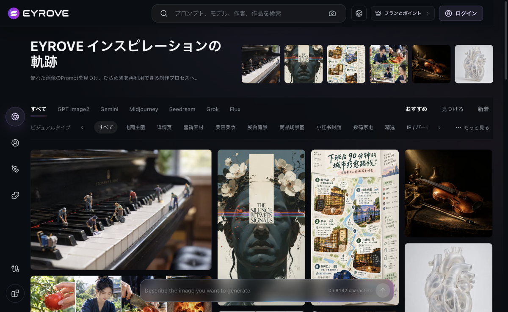
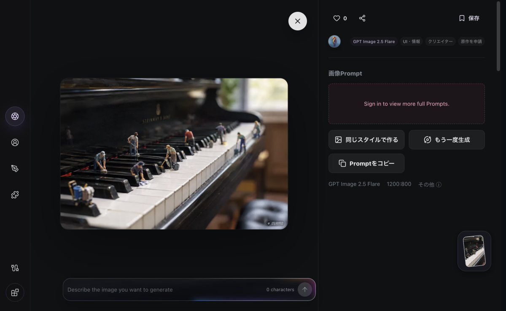

# EYROVE

**100,000+ free AI image prompts, one prompt compared across models, and one-click recreation.**

EYROVE is a free prompt library and image generator for AI images. Five things define it:

1. **One prompt, many models.** A creative direction is filed across image models, so the same brief can be read side by side as GPT Image, Gemini, Midjourney, Seedream, Grok or Flux renders it, and you can see how composition, material and light shift before committing to one.
2. **A free library of 100,000+ prompts.** Browsing needs no account. Filter by model or by visual type — portraits, posters, e-commerce product scenes, brand visuals, illustration, spatial concepts — search by text or by image, in seven languages. Every case keeps its prompt, model, aspect ratio, creator and source.
3. **One-click same-style generation.** Open any case, then recreate it in the same style, generate again, or copy the prompt.
4. **A generator with no sign-up.** eyrove.com/en/free-ai-image-generator generates without an account and downloads without a platform watermark. One image per run, several aspect ratios; the free queue pauses when the daily capacity runs out.
5. **A browser extension that reverses prompts.** Eyrove Prompt (Chrome) hovers or selects an image on any page and turns it into an editable prompt through an eight-dimension analysis: subject, composition, style, light and colour, material, pose, layout, constraints. Images that carry generation metadata give their original prompt and model back for free.

## Beyond the five

The same workspace holds six single-purpose tools at https://eyrove.com/app?workspace=skills — prompt reverse, upscale and restore, product retouch across seven materials, portrait retouch that keeps identity, plus batch compression and resize, which run locally and never upload the image.

For coding agents there is a local MCP server at https://eyrove.com/app?workspace=mcp: eyrove-image-mcp v0.2.1, Node.js 22+, eight tools, working with Codex, Claude Code and Cursor on the user's own account key and points.

## Links

- Product: https://eyrove.com
- Prompt library: https://eyrove.com/app
- Free generator, no account: https://eyrove.com/en/free-ai-image-generator
- Chrome extension: https://eyrove.com/zh-cn/eyrove-prompt
- SkillHub tools: https://eyrove.com/app?workspace=skills
- MCP server: https://eyrove.com/app?workspace=mcp
- Open-source BYOK extension: https://github.com/geslie1/eyrove-prompt-lite
- Guides: https://eyrove.com/en/guides

## Details

| | |
|---|---|
| Category | AI prompt library · AI image generation · browser extension · MCP server |
| Models | GPT Image, Gemini, Midjourney, Seedream, Grok, Flux |
| Prompts | 100,000+ |
| Languages | 7 |
| Pricing | Free to browse and generate; paid plans add credits and concurrency |
| Contact | support@eyrove.com |

## License

This repository holds the product showcase, not the application source. The BYOK browser extension is open source under its own license in the repository linked above.
